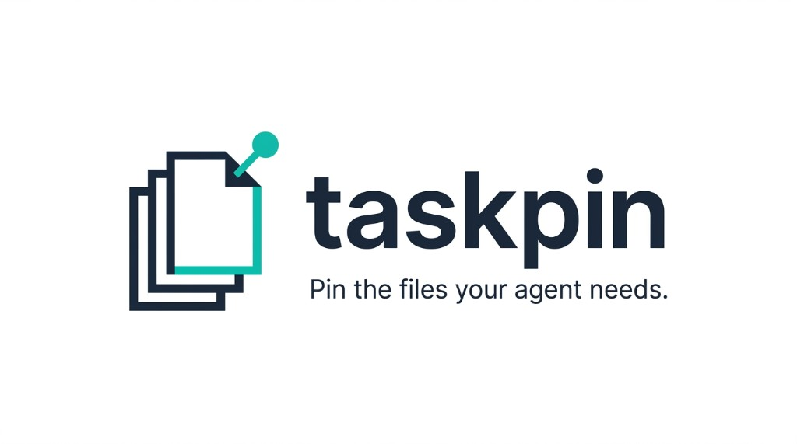
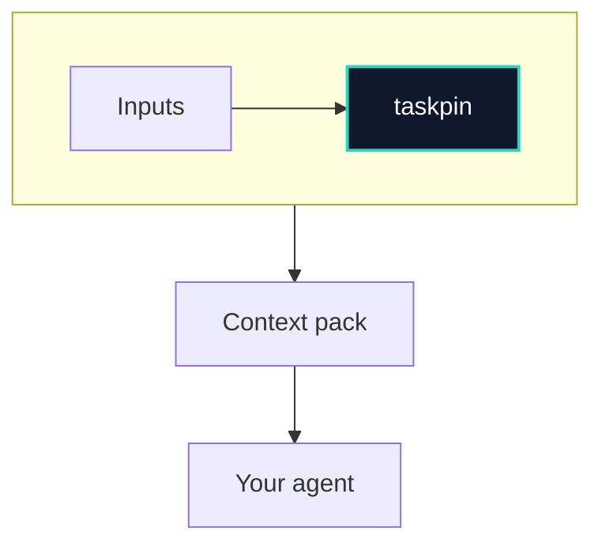
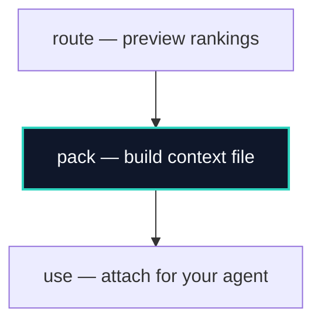

<p align="center">
  <a href="https://github.com/ajxdevx/Taskpin">
    
  </a>
</p>

<p align="center">
  <a href="https://github.com/ajxdevx/Taskpin/blob/main/LICENSE"></a>
  <a href="https://nodejs.org/"></a>
  
  
</p>

<p align="center">
  <strong>Local CLI that builds small, explainable context packs for AI coding agents.</strong><br/>
  Point it at your repo, describe the task, set a token budget — get the files that matter, with reasons.<br/>
  <em>Cursor, Claude Code, Copilot, Windsurf, Cline, custom agents — markdown, JSON, or MCP.</em>
</p>

---

## Table of contents

- [Why taskpin](#why-taskpin)
- [How it works](#how-it-works)
- [Workflow: route, pack, use](#workflow-route-pack-use)
- [Install](#install)
- [Quick start](#quick-start)
- [Commands](#commands)
- [Options](#options)
- [Project config](#project-config-taskpinjson)
- [How files are chosen](#how-files-are-chosen)
- [Safety](#secrets-and-safety)
- [Output formats](#output-formats)
- [MCP and agent integrations](#mcp-and-agent-integrations)
- [Sessions, index, CI](#sessions-manifest--delta)
- [License](#license)

---

## Why taskpin

Coding agents work best when they see **the right slice** of your codebase — not the whole tree, not random `@` mentions.

| Without taskpin | With taskpin |
| --- | --- |
| Huge paste or vague `@folder` | Ranked files under a **token budget** |
| No idea why a file was included | **Per-file reasons** (`keyword-match`, `branch-diff`, …) |
| Secrets might leak into chat | **Redaction** and `check` / CI scan |
| Cloud context services | **100% local** — no account, no API keys |

---

## How it works

**In one sentence:** you give **repo + task + budget** → taskpin **discovers, scores, and packs** → you feed the result to **any agent** (chat paste, MCP, or CI artifacts).



**Row 1:** your repo, task, and token budget → **taskpin** runs locally. **Row 2:** ranked files become a pack (markdown or JSON). **Row 3:** any agent (chat, MCP, CI).

| Step | What happens |
| --- | --- |
| **1. Inputs** | You name the job (`fix auth redirect`), optional paths/symbols, and how many tokens the agent can afford. |
| **2. Discover & score** | taskpin walks allowed files (respects `.gitignore`), searches for your task, uses git/import/test signals, and fuses scores. |
| **3. Pack** | Top files fill the budget — full file, slice, or signature. Almost-made-it paths land in **omitted** with a reason. |
| **4. Use** | Paste markdown, attach JSON, call **MCP**, or upload a **GitHub Action** artifact. |

---

## Workflow: route, pack, use

Use **`route`** to preview rankings (no file bodies). Use **`pack`** when you are happy. Paste or attach the output in **any** agent, or wire **MCP** / **CI**.



**Commands:** `taskpin route --task "…"` → `taskpin pack --out context.md` → attach in chat, MCP, or CI.

| Command | When to use it |
| --- | --- |
| `taskpin route --task "…"` | “Would it pick the files I expect?” — fast, no content dump. |
| `taskpin pack --task "…"` | “Give me the actual context file for the agent.” |
| `taskpin explain <path> --task "…"` | “Why was this file skipped or included?” |

**Tip:** Put real paths and symbols in the task (`src/auth/middleware.ts`, `parseSession`). Vague tasks like `fix bug` still run but rank worse and may warn you.

---

## What you get

- **Markdown or JSON** you can paste into chat or pipe to an agent
- **Per-file reasons** (`keyword-match`, `import-neighbor`, `branch-diff`, …)
- **Scores and signals** in JSON (`signals[]`, fused score, omitted receipts)
- **Budget-aware packing** — match slices and signatures when full files do not fit
- Optional **MCP server**, **GitHub Action**, and **`taskpin init`** templates (AGENTS.md + optional editor hooks)

---

## Requirements

- **[Node.js 20+](https://nodejs.org/)**
- **Git** (optional but recommended — recent files, branch diff, pickaxe work without it with a warning)
- **Search:** [ripgrep (`rg`)](https://github.com/BurntSushi/ripgrep) on your PATH, or use the bundled `@vscode/ripgrep` from the npm package

Check your machine:

```bash
taskpin doctor
```

---

## Install

### npm (recommended)

```bash
npm install -g taskpin
taskpin doctor
```

### Run once without installing

```bash
npx taskpin pack --root /path/to/your/project --task "fix login redirect" --budget 8000
```

After the package is on npm, you can also use `npx taskpin@latest …`.

### Build from this repository

```bash
git clone https://github.com/ajxdevx/Taskpin.git
cd Taskpin
npm ci
npm run build
npm link
taskpin doctor
```

---

## Quick start

Run taskpin from **your application’s git root** (where your source lives):

```bash
cd /path/to/your-app
taskpin doctor   # optional: Node, rg, git

# 1) Preview which files would be picked (fast — no file bodies)
taskpin route --task "auth middleware session cookie" --budget 8000

# 2) Build the pack (pick a profile for your tool, or use default)
taskpin pack --task "auth middleware session cookie" --budget 12000 --profile default --out context.md
```

Use a task that matches **your** code (paths, feature names, symbols). Mention a file in the task if you want it prioritized (`src/auth/middleware.ts`).

| Your tool | Suggested `--profile` |
| --- | --- |
| Any chat / manual paste | `default` |
| Cursor | `cursor` |
| Claude Code / Claude projects | `claude` |
| GitHub Copilot | `copilot` |
| Scripts / pipelines | `--format json` (profile optional) |

---

## Commands

| Command | What it does |
| --- | --- |
| `pack` | Build a context pack (default when you pass `--task`) |
| `route` | Rank files and reasons **without** reading file bodies |
| `changed` | Pack files changed on the current branch vs `--base` (default task: review changes) |
| `delta` | Refresh a pack using `.taskpin/manifest.json` from a previous `pack --save-manifest` |
| `explain <path>` | Why one path was packed, omitted, or blocked |
| `stats` | Token tree of packable files under the project |
| `doctor` | Node version, ripgrep, git, project root |
| `check` | Scan the repo for suspected secrets (exit code 1 if any) |
| `schema` | Print JSON Schema for pack output |
| `index` | Build `.taskpin/file-index.json` for faster path matching |
| `stale` | Show paths that changed since the last index (exit 2 if re-index needed) |
| `mcp` | Start MCP server on stdio (`route`, `get_context_pack`, `get_delta_context`) |
| `ci` | Secret scan, then pack from a GitHub PR/issue event (for Actions) |
| `init` | Install AGENTS.md snippet + optional editor templates (Cursor rule/hooks; skip with `--no-rule` / `--no-hook`) |

### Common examples

```bash
taskpin pack --task "fix hero mood bug" --budget 8000
taskpin route --task "auth middleware"
taskpin changed --base main --task "review PR"
taskpin explain src/auth.ts --task "why is this file included"
taskpin pack --task "same as before" --save-manifest
taskpin delta --task "same as before"
taskpin pack --task "auth" --since HEAD~5
taskpin index && taskpin pack --task "navbar" --use-index
taskpin check --root .
taskpin stats --model claude --min-tokens 500
```

### Monorepo

```bash
taskpin --root /path/to/monorepo --scope apps/web --task "fix checkout button"
```

Git signals run from the repo root; packed paths are relative to the scope folder.

---

## Options

CLI flags override [`.taskpin.json`](./.taskpin.json.example) in the project root.

| Option | Description |
| --- | --- |
| `--root <path>` | Project or git repo root (default: current directory) |
| `--scope <path>` | Subfolder under `--root` (e.g. `apps/web`) |
| `--task <text>` | What you are trying to do (required for `pack`, `route`, `explain`, `delta`) |
| `--budget <n>` | Token budget (default: 8000, minimum 500) |
| `--model <name>` | Token estimator: `claude`, `gpt`, `gemini`, `ollama`, `chars4` |
| `--profile <name>` | Output shape: `default`, `cursor`, `claude`, `copilot` |
| `--format <fmt>` | `markdown` or `json` |
| `--out <file>` | Write output to a file instead of stdout |
| `--base <ref>` | Git base for `changed` (e.g. `main`) |
| `--since <ref>` | Boost files changed since a commit or branch |
| `--manifest <path>` | Session manifest path (default: `.taskpin/manifest.json`) |
| `--save-manifest` | Save manifest after pack (for `delta` later) |
| `--refresh` | Reuse unchanged bodies from manifest (`delta`) |
| `--use-index` | Use `.taskpin/file-index.json` when fresh |
| `--index <path>` | Custom index path |
| `--no-redact` | Do not redact inline secrets in packs (not recommended) |
| `--min-tokens <n>` | For `stats`: hide small directories |

Legacy style still works: `taskpin --task "…" --budget 8000`, `taskpin --route --task "…"`, `taskpin --print-schema`, etc.

---

## Project config (`.taskpin.json`)

Copy [`.taskpin.json.example`](./.taskpin.json.example) to your repo:

```json
{
  "budget": 8000,
  "model": "claude",
  "profile": "default",
  "format": "markdown",
  "base": "main",
  "redactSecrets": true,
  "task": "optional default task",
  "since": "HEAD~5",
  "saveManifest": false,
  "useIndex": true,
  "scope": "apps/web"
}
```

---

## How files are chosen

taskpin combines several signals, then **fuses** them with caps so one signal cannot flood the pack.

| Source | Reason tag in output |
| --- | --- |
| `AGENTS.md`, `CLAUDE.md`, `.cursor/rules/*` | `agent-rules` |
| `README.md` | `readme` |
| Keywords and phrases from search (`rg`) | `keyword-match`, `phrase-match` |
| Paths and filenames mentioned in the task | `path-match` |
| Recent commits | `recent-change` |
| Current branch vs base | `branch-diff` |
| Symbol history (`git log -S`) | `pickaxe` |
| Files changed since `--since` | `since-change` |
| Import neighbors (JS/TS, 1–2 hops) | `import-neighbor` |
| Colocated / paired tests | `test-pair` |
| Build/auth/test-related configs when relevant | `entrypoint` |

**Output details:**

- Each file has **reasons**, **score**, and **signals[]** (in JSON).
- Files that almost made it appear under **omitted** with a reason (`budget`, `blocked-secret`, …).
- Large files may be included as **match slices** or **signatures** to fit the budget.
- **`taskpin route`** and **`taskpin explain`** help you debug ranking without loading full file text.

### What is never packed (by default)

- Paths in **`.gitignore`** and **`.cursorignore`**
- Common deny paths (e.g. `.env`, credentials patterns)
- **Binaries** and very large files (512KB cap per file)
- **`node_modules`**, most **lockfiles** (unless your task mentions deps/locks)
- **`vendor/`** (unless the task mentions vendor)

---

## Secrets and safety

- **Default:** inline API keys and similar patterns are **redacted** in packs (`secret-redacted`).
- **Private key files** are **blocked** — listed under `blockedSecrets`, not included.
- **`taskpin check`** scans the tree and exits with code 1 if suspected secrets are found (use in CI before sharing context).
- **`taskpin ci`** (GitHub Action) runs **check first**, then packs — the job fails if secrets are found.

Only use `--no-redact` if you accept putting live tokens into the pack.

---

## Output formats

### JSON

- `schema_version`: `1.0`
- `$schema`: see `schema/context-pack.schema.json` or `taskpin schema`
- Full structure: task parse summary, git meta, workspace scope, files, omitted, blocked secrets

```bash
taskpin pack --task "auth" --format json --out pack.json
```

### Markdown profiles

| Profile | Use for |
| --- | --- |
| `default` | Plain markdown — works in **any** agent chat |
| `cursor` | Cursor-optimized layout (lists paths, then code blocks) |
| `claude` | Claude-style `<taskpin_context>` wrapper |
| `copilot` | GitHub Copilot–friendly layout |

```bash
taskpin pack --task "auth" --profile claude --out context.md
taskpin pack --task "auth" --format json --out pack.json   # any agent / pipeline
```

---

## Sessions (manifest + delta)

For repeated work on the **same task**:

```bash
taskpin pack --task "refactor billing service" --save-manifest
# later, same task:
taskpin delta --task "refactor billing service"
```

Manifest: `.taskpin/manifest.json` (blob hashes + redacted bodies). Unchanged files are reused without re-reading disk.

---

## Faster path matching (index)

```bash
taskpin index
taskpin stale          # exit 2 if index is out of date
taskpin pack --task "…" --use-index
```

Index file: `.taskpin/file-index.json`.

---

## MCP and agent integrations

### MCP server (any MCP-capable client)

Works with **Cursor, Claude Desktop, VS Code extensions, and other MCP hosts** — not tied to one vendor.

Tools: **`route`**, **`get_context_pack`**, **`get_delta_context`**. Paths are sandboxed to the server root.

```bash
taskpin mcp --root /path/to/your/project
```

- Run **`taskpin-mcp`** with `TASKPIN_ROOT` set, or wire `npx taskpin mcp` in your host’s MCP config.
- Example snippet for Cursor: [docs/mcp.cursor.json](./docs/mcp.cursor.json) and [mcp.cursor.snippet.json](./docs/integrations/mcp.cursor.snippet.json) (adapt the same command for other hosts).

Pass `profile` in tool args (`default`, `cursor`, `claude`, `copilot`) to match your agent.

### `taskpin init` (project templates)

```bash
taskpin init
```

Installs into **your** repo:

- **AGENTS.md** snippet — instructions for **any** coding agent (Claude, Copilot, Cursor, etc.)
- **Optional (Cursor):** `.cursor/rules/taskpin.mdc` and a prompt hook that writes `.taskpin/hook-pack.md` (see [docs/integrations](./docs/integrations/README.md))

Flags: `--no-agents`, `--no-rule`, `--no-hook`, `--force`. Use `--no-rule` and `--no-hook` if you only want the AGENTS snippet.

---

## GitHub Action (PR / issue context)

In **your** repository workflow:

```yaml
name: taskpin context

on:
  pull_request:
    types: [opened, synchronize, reopened]
  issues:
    types: [opened, edited]

jobs:
  context:
    runs-on: ubuntu-latest
    steps:
      - uses: actions/checkout@v4
        with:
          fetch-depth: 0
      - uses: ajxdevx/Taskpin@v1
        with:
          budget: "12000"
          profile: default
```

Artifacts (by default): `taskpin-output/` — `taskpin-context.md`, `.json`, comment-friendly markdown, summary.

Inputs include `task`, `budget`, `mode` (`auto` | `pack` | `changed` | `scan`), `scope`, `profile`. See [action.yml](./action.yml).

Local dry-run:

```bash
taskpin ci --event-path /path/to/event.json --root .
```

---

## Typical workflows

| Goal | Command |
| --- | --- |
| Paste context into any agent chat | `taskpin pack --task "…" --profile default --out ctx.md` |
| Claude / Copilot-shaped markdown | `taskpin pack --task "…" --profile claude` or `--profile copilot` |
| Agent calls taskpin over MCP | `taskpin mcp --root .` then `get_context_pack` |
| See what would be picked | `taskpin route --task "…"` |
| PR review context | `taskpin changed --base main` |
| Why was `foo.ts` skipped? | `taskpin explain foo.ts --task "…"` |
| Repo hygiene before AI | `taskpin check` |
| Big monorepo package | `taskpin pack --root . --scope packages/api --task "…"` |

---

## License

MIT — see [LICENSE](./LICENSE).

Repository: [github.com/ajxdevx/Taskpin](https://github.com/ajxdevx/Taskpin)
